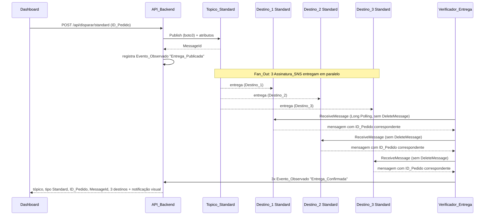
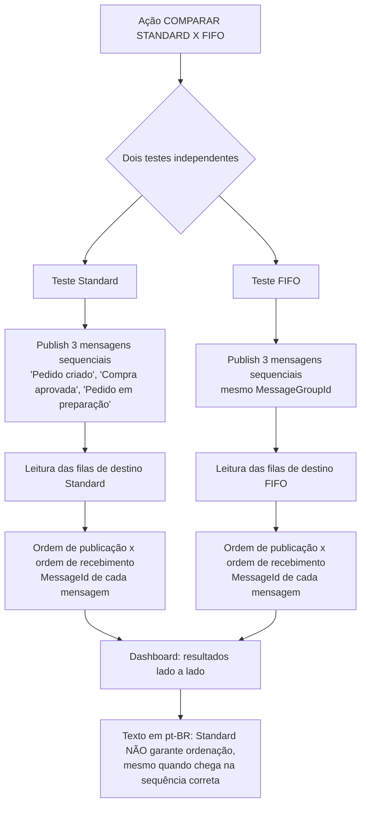
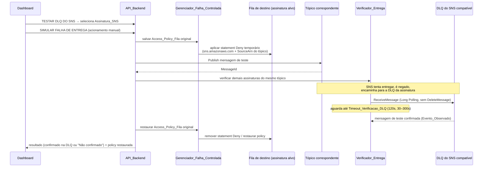
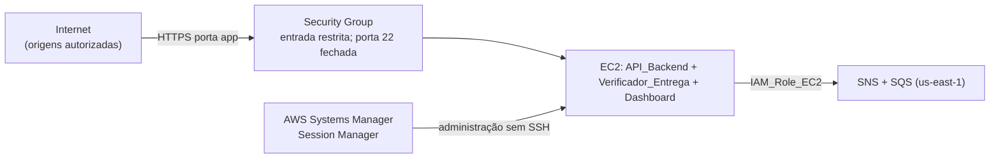
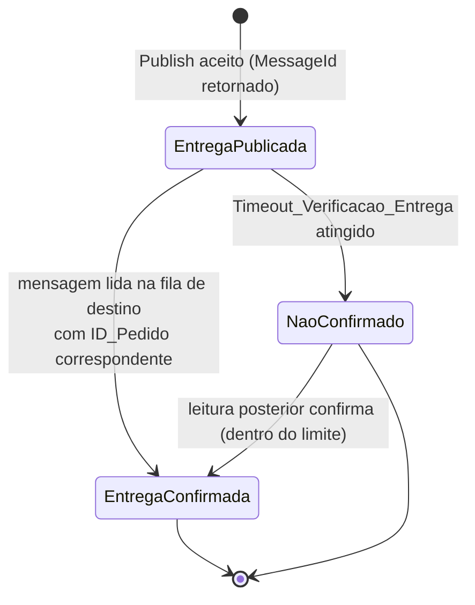

# Documento de Design

## Overview

Este documento descreve o design técnico do laboratório didático **AWS SNS Delivery Lab**, voltado ao estudo da certificação **AWS Solutions Architect Associate (SAA)**. A solução demonstra visualmente o ciclo de vida completo das mensagens publicadas pelo **Amazon SNS** — publicação em tópicos, distribuição **fan-out** para múltiplas assinaturas, ordenação de mensagens (Standard vs FIFO), confirmação de entrega real nas filas de destino, falha de entrega controlada e encaminhamento para a **Dead-Letter Queue (DLQ) do SNS**.

O laboratório foca **exclusivamente no Amazon SNS**. O **Amazon SQS** participa **apenas como destino** das mensagens publicadas pelo SNS (padrão fan-out). Nenhuma funcionalidade educacional específica de SQS é desenvolvida aqui: as filas SQS existem somente para receber as entregas do SNS e permitir a **confirmação real** dessas entregas por meio de leitura não destrutiva.

O cenário educacional é um fluxo de **delivery de comida**: após a aprovação de uma compra, o SNS distribui a mensagem para três destinos — **Destino_1** (confirmação da aprovação da compra), **Destino_2** (solicitação para a cozinha preparar o alimento) e **Destino_3** (solicitação para o motoboy buscar o pedido). O Dashboard apresenta a notificação visual em pt-BR **"Seu pedido foi aprovado e está sendo preparado"**. Essa notificação é **apenas visual**: o laboratório **não envia SMS nem e-mails reais**.

A aplicação é executada integralmente em uma instância **Amazon EC2** Linux na região `us-east-1`, autenticando-se na AWS exclusivamente pela **IAM_Role_EC2** (credenciais temporárias, sem Access Keys fixas). O backend em Python expõe a **API_Backend** (`FastAPI`) e hospeda o processo **Verificador_Entrega**, todos usando `boto3`. O **Dashboard** (HTML/CSS/JS) consome a API e apresenta, em pt-BR, as quatro ações principais do laboratório: "DISPARAR SNS STANDARD", "DISPARAR SNS FIFO", "COMPARAR STANDARD X FIFO" e "TESTAR DLQ DO SNS".

A **confirmação de entrega** de cada mensagem é obtida pela **leitura real das filas SQS de destino** via `boto3`, correlacionando as mensagens pelo **ID_Pedido**. A aplicação distingue de forma explícita e didaticamente honesta dois estados: **Entrega_Publicada** (o SNS aceitou publicar e retornou um `MessageId`) e **Entrega_Confirmada** (a mensagem foi efetivamente lida na fila de destino correspondente). Quando a verificação não confirma a mensagem dentro do tempo-limite, o estado exibido é **"Não confirmado"**, nunca "entregue".

### Decisões de design fundamentais

| Decisão | Rationale |
|---------|-----------|
| Confirmação de entrega **somente** por leitura real da fila de destino | O SNS retornar um `MessageId` significa apenas que a publicação foi aceita, não que a mensagem chegou ao destino. A honestidade didática exige distinguir Entrega_Publicada de Entrega_Confirmada, confirmando esta última apenas quando a mensagem é lida na fila de destino e correlacionada pelo ID_Pedido (Req. 6.1, 6.2, 6.3). |
| Leitura **não destrutiva** das filas de destino (sem DeleteMessage) | As filas podem conter mensagens de outros testes ou usuários. O Verificador_Entrega apenas visualiza, usando VisibilityTimeout curto e sem exclusão, preservando as mensagens de terceiros (Req. 6.4, 10.4, 10.7). |
| Distinção explícita entre Evento_Observado e Evento_Inferido | O laboratório é didaticamente honesto sobre o que foi confirmado via AWS (publicação com MessageId, leitura confirmada na fila/DLQ) e o que é apenas deduzido (Req. 4.3, 6.3, 8.6). |
| Dois timeouts distintos: Timeout_Verificacao_Entrega e Timeout_Verificacao_DLQ | A entrega em fila de destino é rápida (padrão 30s, faixa 5–120s); o encaminhamento para a DLQ do SNS depende da política de retry do SNS e é mais lento (padrão 120s, faixa 30–300s) (Req. 2.5, 6.5, 8.5). |
| Falha de entrega **controlada e reversível** via Access_Policy_Fila | Para demonstrar a DLQ do SNS sem excluir recursos, adiciona-se um statement `Deny` temporário à Access_Policy_Fila da fila de destino, negando o recebimento vindo do SNS daquela assinatura; ao final, a policy original é restaurada integralmente (Req. 8.2, 8.8, 8.10). |
| Deduplicacao_Por_Conteudo **habilitada por padrão** no Topico_FIFO | Simplifica o cenário FIFO: o `MessageDeduplicationId` é gerado pelo conteúdo, dispensando sua informação manual quando habilitada (Req. 2.3, 5.4, 11.3). |
| Recursos AWS criados **manualmente** (sem IaC) | Objetivo didático: praticar criação e configuração no Console AWS. A aplicação apenas verifica e usa recursos existentes, exceto o ajuste temporário de Access_Policy_Fila (Req. 1.8, 1.10, 1.12, 16). |
| Autenticação exclusiva via **IAM_Role_EC2** | Boa prática de segurança: nenhuma Access Key fixa em código, config ou variável de ambiente (Req. 12.1, 12.2). |
| Limites de execução: disparo **manual**, sem loops/carga, botão desabilitado durante o teste | Evita loops, custos indevidos e resultados inconsistentes; cada teste roda uma vez por acionamento manual (Req. 9.1, 9.2, 9.3, 9.4). |

### Escopo e não-escopo

- **Escopo:** aplicação web (API_Backend + Verificador_Entrega + Dashboard), lógica de publicação SNS (Standard e FIFO), confirmação de entrega real por leitura não destrutiva, comparação Standard x FIFO, falha de entrega controlada e verificação de DLQ do SNS, segurança da aplicação, observabilidade e documentação.
- **Não-escopo (feito manualmente pelo usuário):** criação de tópicos SNS, assinaturas, filas de destino, DLQs, Access Policies, IAM Role, EC2 e Security Groups. A aplicação **não** cria, modifica nem exclui recursos AWS, exceto o ajuste temporário e reversível de Access_Policy_Fila do cenário de Falha_Entrega_Controlada (Req. 1.8, 1.10).
- **Não-escopo (educacional):** nenhuma funcionalidade educacional de SQS (reentrega, Visibility_Timeout de processamento, DLQ de processamento). As filas de destino existem apenas para confirmar as entregas do SNS (Req. 10.7).

## Architecture

### Visão geral da arquitetura

```mermaid
graph TB
    subgraph Usuario["Navegador do estudante"]
        BROWSER["Dashboard pt-BR<br/>AWS SNS Delivery Lab<br/>(HTML/CSS/JS)"]
    end

    subgraph EC2["Instância EC2 Linux (us-east-1)"]
        API["API_Backend<br/>(FastAPI + boto3)"]
        VERIF["Verificador_Entrega<br/>(leitura não destrutiva)"]
        SNSGW["SnsGateway<br/>(acesso SNS)"]
        SQSRGW["SqsLeituraGateway<br/>(leitura somente)"]
        GFC["Gerenciador_Falha_Controlada"]
        INIT["Verificacao_Inicializacao"]
        SEG["Seguranca (login/bloqueio)"]
        OBS["Observabilidade/estatísticas"]
    end

    subgraph AWS["Serviços AWS gerenciados (us-east-1)"]
        TS["Topico_Standard<br/>(SNS Standard)"]
        TF["Topico_FIFO<br/>(SNS FIFO)"]
        subgraph DEST_S["Filas de destino Standard"]
            QS1["Destino_1 Standard"]
            QS2["Destino_2 Standard"]
            QS3["Destino_3 Standard"]
        end
        subgraph DEST_F["Filas de destino FIFO"]
            QF1["Destino_1 FIFO"]
            QF2["Destino_2 FIFO"]
            QF3["Destino_3 FIFO"]
        end
        DLQS["DLQ_SNS_Standard<br/>delivery-sns-dlq-standard"]
        DLQF["DLQ_SNS_FIFO<br/>delivery-sns-dlq.fifo"]
    end

    BROWSER -->|HTTPS| API
    API --> SNSGW
    API --> VERIF
    API --> GFC
    API --> SEG
    API --> OBS
    API --> INIT
    VERIF --> SQSRGW

    SNSGW -->|Publish| TS
    SNSGW -->|Publish| TF
    TS -->|Fan_Out (3 Assinatura_SNS)| DEST_S
    TF -->|Fan_Out (3 Assinatura_SNS)| DEST_F
    TS -.->|Redrive_Policy_SNS| DLQS
    TF -.->|Redrive_Policy_SNS| DLQF
    SQSRGW -->|ReceiveMessage (sem DeleteMessage)| DEST_S
    SQSRGW --> DEST_F
    SQSRGW --> DLQS
    SQSRGW --> DLQF

    API -. IAM_Role_EC2 (credenciais temporárias) .-> AWS
```

A autenticação de todos os componentes com a AWS ocorre pela **IAM_Role_EC2** anexada ao perfil da instância; o `boto3` resolve as credenciais temporárias automaticamente via metadata service (IMDSv2), sem Access Keys (Req. 12.1, 12.2).

### Fluxo fan-out Standard — caminho feliz



### Fluxo fan-out FIFO — ordenação por MessageGroupId

```mermaid
sequenceDiagram
    participant U as Dashboard
    participant API as API_Backend
    participant SNS as Topico_FIFO
    participant QF as Filas de destino FIFO (Destino_1..3)
    participant V as Verificador_Entrega

    U->>API: POST /api/disparar/fifo (ID_Pedido, MessageGroupId)
    Note over API: Deduplicacao_Por_Conteudo HABILITADA → não solicita MessageDeduplicationId
    API->>SNS: Publish (MessageGroupId; dedup por conteúdo)
    SNS-->>API: MessageId
    API->>API: registra Evento_Observado "Entrega_Publicada"
    Note over SNS,QF: Fan_Out ordenado por MessageGroupId para as 3 filas FIFO
    SNS-->>QF: entrega preservando ordem do grupo
    V->>QF: ReceiveMessage (Long Polling, sem DeleteMessage)
    QF-->>V: mensagens na ordem do MessageGroupId
    V->>API: Evento_Observado "Entrega_Confirmada" por destino
    API-->>U: tópico, tipo FIFO, ID_Pedido, MessageGroupId, MessageId, 3 destinos
```

A fila FIFO entrega as mensagens de um mesmo `MessageGroupId` em ordem. A aplicação **apresenta** a ordem observada na leitura, **sem reconstruir ou reordenar** as mensagens (Req. 11.1).

### Comparação Standard x FIFO



A comparação executa dois testes **independentes** e exibe os resultados **lado a lado**. O design deixa explícito que o **Topico_Standard não garante ordenação**, mesmo quando as mensagens chegam na sequência correta; a aplicação **não** simula artificialmente mensagens fora de ordem (Req. 7.6, 7.7).

### Fluxo de Falha_Entrega_Controlada → DLQ do SNS



O cenário **nunca exclui filas nem assinaturas** e **exige acionamento manual** do usuário. Se a restauração da policy falhar, o Dashboard identifica a fila afetada e orienta a restauração manual pelo Console AWS (Req. 8.9, 8.10).

### Topologia de rede e implantação



A arquitetura não usa **NAT Gateway** nem **Elastic Load Balancer** (salvo justificativa técnica documentada), e a administração da EC2 ocorre apenas via **Session_Manager**, com a porta 22 (SSH) sem regra de entrada liberada (Req. 15.1, 15.2, 15.3).

## Components and Interfaces

### API_Backend (FastAPI)

Serviço HTTP que expõe os endpoints consumidos pelo Dashboard e orquestra publicação, verificação de entrega, comparação, teste de DLQ, estatísticas e configuração. Responde em pt-BR e valida todas as entradas antes de agir.

Endpoints principais (contrato lógico):

| Método | Rota | Responsabilidade | Requisitos |
|--------|------|------------------|------------|
| `GET` | `/api/saude` | Verificação de inicialização: existência e acessibilidade dos recursos AWS | 1.9, 1.11 |
| `GET` | `/api/config` | Retorna Config_Aplicada e Config_Simulacao com rótulos distintos | 2.1–2.9 |
| `PUT` | `/api/config/simulacao` | Ajusta Timeout_Verificacao_Entrega e Timeout_Verificacao_DLQ dentro das faixas | 2.5, 2.7, 2.8 |
| `POST` | `/api/disparar/standard` | Publica no Topico_Standard e dispara verificação de entrega | 4.1–4.8 |
| `POST` | `/api/disparar/fifo` | Publica no Topico_FIFO (MessageGroupId) e dispara verificação | 5.1–5.10, 11.5 |
| `POST` | `/api/comparar` | Executa testes Standard e FIFO e retorna resultados lado a lado | 7.1–7.9 |
| `POST` | `/api/dlq/simular-falha` | Prepara Falha_Entrega_Controlada, publica, verifica DLQ e restaura policy | 8.1–8.11 |
| `GET` | `/api/estatisticas` | Estatísticas agregadas por cenário (Standard/FIFO), publicadas/confirmadas/DLQ | 3.4–3.10 |
| `GET` | `/api/arquitetura` | Dados da representação visual da arquitetura | 3.1, 3.2 |
| `POST` | `/api/autenticacao` | Login do Dashboard (usuário/senha) com bloqueio após 5 tentativas | 12.5, 12.6 |

Características transversais:
- Timeout de 3 s no percentil 95 sob 10 requisições simultâneas para `/api/estatisticas` e para resultados de teste; ao exceder, retorna indicação de timeout e o Dashboard preserva os últimos dados válidos (Req. 14.1–14.3).
- Toda falha de autorização via IAM_Role_EC2 interrompe a operação afetada, registra o evento e expõe erro sem persistir dados parciais (Req. 12.9).
- Cada teste só executa por acionamento manual; enquanto ativo, o botão correspondente permanece desabilitado (Req. 9.1, 9.3, 9.4).

### SnsGateway (camada de acesso ao SNS)

Encapsula o cliente `boto3` do SNS. Centraliza a publicação em tópicos Standard e FIFO, o repasse do erro original da AWS e a montagem dos atributos de mensagem.

Operações principais (assinaturas lógicas):

- `publicar_standard(topic_arn, order_id, conteudo, atributos) -> MessageId`
- `publicar_fifo(topic_arn, order_id, conteudo, message_group_id, message_deduplication_id=None) -> MessageId`
- `obter_assinaturas(topic_arn) -> list[Assinatura_SNS]`

Regras:
- No FIFO, informa sempre `MessageGroupId`; informa `MessageDeduplicationId` **apenas** quando a Deduplicacao_Por_Conteudo estiver desabilitada (Req. 5.3, 5.4, 11.3).
- Publicação FIFO sem `MessageGroupId` é rejeitada antes da chamada ao SNS (Req. 11.5).
- Em falha de publicação, repassa o erro original da AWS sem mascarar (Req. 4.8, 5.10).

### Verificador_Entrega e SqsLeituraGateway (leitura somente)

O **Verificador_Entrega** confirma entregas lendo as filas de destino de forma **não destrutiva**, correlacionando pelo ID_Pedido. A **SqsLeituraGateway** encapsula o cliente `boto3` do SQS restrito a operações de leitura.

Operações principais (assinaturas lógicas):

- `verificar_entrega(queue_url, order_id, timeout_s) -> ResultadoVerificacao`
- `receber_para_visualizacao(queue_url, wait_time_seconds, visibility_timeout_s) -> list[MensagemRecebida]`
- `verificar_dlq(dlq_url, order_id, timeout_s) -> ResultadoVerificacao`

Regras de leitura não destrutiva:
- Usa `ReceiveMessage` com **Long Polling** (`WaitTimeSeconds` de 1 a 20 s, até 20 s no cenário padrão) (Req. 10.5, 14.4).
- **Nunca** chama `DeleteMessage`; usa `VisibilityTimeout` curto para que a mensagem volte a ficar visível a outros testes/usuários (Req. 6.4, 10.4).
- Correlaciona cada mensagem recebida pelo ID_Pedido extraído do envelope SNS; mensagens não correlacionadas ao teste são ignoradas e preservadas (Req. 6.1, 10.1, 10.2).
- Repete tentativas apenas até atingir o Timeout_Verificacao, sem registrar erro quando o retorno vem vazio (Req. 10.6).
- Ao atingir o timeout sem confirmar, retorna estado **"Não confirmado"**, nunca "entregue" (Req. 6.6, 7.9, 8.7).

**Limitação e honestidade didática:** como a leitura é não destrutiva e as filas são compartilhadas, não há garantia de ver todas as mensagens de uma só chamada; a aplicação lê repetidamente até o Timeout_Verificacao e, se não correlacionar o ID_Pedido, exibe "Não confirmado" de forma transparente, sem afirmar entrega.

### Gerenciador_Falha_Controlada

Prepara e reverte a Falha_Entrega_Controlada manipulando a Access_Policy_Fila da fila de destino da assinatura selecionada, de forma temporária e reversível.

Operações principais (assinaturas lógicas):

- `salvar_policy_original(queue_url) -> Policy`
- `aplicar_deny_temporario(queue_url, topic_arn) -> None`
- `restaurar_policy(queue_url, policy_original) -> ResultadoRestauracao`

Regras:
- Salva a Access_Policy_Fila original **antes** de qualquer alteração.
- Adiciona um statement `Deny` para o principal `sns.amazonaws.com` com condição por `SourceArn` do tópico correspondente, negando o recebimento daquela assinatura (Req. 8.2).
- **Não** exclui filas nem assinaturas (Req. 8.2).
- Ao final, restaura a policy original integralmente (Req. 8.8); se a restauração falhar, sinaliza a fila afetada e orienta a restauração manual pelo Console AWS (Req. 8.9).

### Verificacao_Inicializacao

Verifica a existência e a acessibilidade de cada recurso AWS esperado antes de disponibilizar o Dashboard: os dois tópicos, as seis assinaturas, as seis filas de destino, as duas DLQs, a IAM Role e a instância EC2.

Operações principais (assinaturas lógicas):

- `verificar_recursos() -> RelatorioInicializacao`
- `verificar_recurso(tipo, nome, timeout_s=10) -> StatusRecurso`

Regras:
- Aplica timeout de 10 s por recurso.
- Se um recurso estiver ausente ou inacessível, registra o erro original da AWS, **interrompe a inicialização sem alterar qualquer recurso** e exibe no Dashboard mensagem em pt-BR identificando o recurso por nome e tipo (Req. 1.9, 1.11).

### Observabilidade / estatísticas

Agrega estatísticas por cenário (Standard e FIFO): total publicado por tópico, Entrega_Confirmada por fila de destino e quantidade em cada DLQ, todos como inteiros ≥ 0. Mantém o horário da última atualização bem-sucedida (data, hora com segundos e fuso) e, em caso de falha, preserva os últimos valores exibidos (Req. 3.4–3.10, 13.1–13.6). Reaproveita a camada de log estruturado existente (`app/observabilidade/log_estruturado.py`).

### Seguranca

Controla o login do Dashboard, o bloqueio por origem após 5 tentativas inválidas consecutivas por 300 s e a restrição de acesso a origens autorizadas. Reaproveita a camada de autenticação existente (`app/seguranca/autenticacao.py`), adaptada ao contexto do laboratório (Req. 12.5, 12.6, 12.7).

### Dashboard

Aplicação web em pt-BR com título "AWS SNS Delivery Lab". Exibe a representação visual da arquitetura (tópicos, assinaturas, filas, DLQs), as quatro ações principais, as estatísticas separadas por cenário, o horário da última atualização e os indicadores textuais distintos de Config_Aplicada/Config_Simulacao e de Entrega_Publicada/Entrega_Confirmada. Atualiza as estatísticas periodicamente (intervalo configurável de 5 a 300 s, padrão 10 s) sem recarregar a página (Req. 3, 13).

## Data Models

### Envelope de mensagem publicada

Toda publicação carrega um envelope de aplicação (payload) que identifica o pedido, o destino e o conteúdo, além dos atributos SNS. O ID_Pedido é a chave de correlação usada na confirmação de entrega.

```json
{
  "id_pedido": "pedido-0001",
  "cenario": "standard",
  "destino": "destino_1",
  "titulo_destino": "Confirmação da aprovação da compra",
  "conteudo": "Seu pedido foi aprovado e está sendo preparado",
  "app_time": "2024-06-25T12:00:00.123Z",
  "sequencia": 1
}
```

### Atributos SNS da publicação

Os atributos de mensagem (`MessageAttributes`) acompanham o ID_Pedido e o cenário, permitindo correlação mesmo quando a leitura inspeciona apenas os atributos:

```json
{
  "id_pedido": { "DataType": "String", "StringValue": "pedido-0001" },
  "cenario": { "DataType": "String", "StringValue": "standard" }
}
```

Para o Topico_FIFO, a publicação informa `MessageGroupId` e, quando a Deduplicacao_Por_Conteudo está desabilitada, `MessageDeduplicationId`.

### Formato recebido na fila de destino (SNS envelope)

Quando o SNS entrega em uma fila SQS sem raw message delivery, a mensagem chega encapsulada no envelope padrão do SNS. O Verificador_Entrega extrai o `Message` e os `MessageAttributes` para correlacionar pelo ID_Pedido:

```json
{
  "Type": "Notification",
  "MessageId": "a1b2c3d4-0001",
  "TopicArn": "arn:aws:sns:us-east-1:123456789012:delivery-standard",
  "Message": "{\"id_pedido\":\"pedido-0001\",\"cenario\":\"standard\",\"destino\":\"destino_1\",\"conteudo\":\"Seu pedido foi aprovado e está sendo preparado\"}",
  "Timestamp": "2024-06-25T12:00:00.456Z",
  "MessageAttributes": {
    "id_pedido": { "Type": "String", "Value": "pedido-0001" },
    "cenario": { "Type": "String", "Value": "standard" }
  }
}
```

### Modelo de estados da entrega

O estado de cada mensagem é **derivado** das observações da aplicação, nunca armazenado como campo mutável que confunda publicação com entrega.



| Estado | Condição de derivação | Classificação |
|--------|-----------------------|---------------|
| `Entrega_Publicada` | O SNS aceitou a publicação e retornou um `MessageId`. | Evento_Observado |
| `Entrega_Confirmada` | A mensagem foi lida na fila de destino e correlacionada pelo ID_Pedido. | Evento_Observado |
| `Não confirmado` | O Timeout_Verificacao foi atingido sem leitura correlacionada. | — (não afirma entrega) |

Regra fundamental: nunca se deriva `Entrega_Confirmada` apenas da aceitação da publicação pelo SNS; exige leitura real na fila de destino (Req. 6.1, 6.2).

### Resultado de verificação

```json
{
  "id_pedido": "pedido-0001",
  "cenario": "standard",
  "destino": "destino_2",
  "estado": "Entrega_Confirmada",
  "message_id": "a1b2c3d4-0001",
  "fila_destino": "delivery-destino2-standard",
  "app_time_confirmacao": "2024-06-25T12:00:05.456Z"
}
```

### Resultado de comparação Standard x FIFO

```json
{
  "standard": {
    "tipo": "Standard",
    "ordem_publicacao": ["Pedido criado", "Compra aprovada", "Pedido em preparação"],
    "ordem_recebimento": ["Compra aprovada", "Pedido criado", "Pedido em preparação"],
    "message_ids": ["id-s1", "id-s2", "id-s3"]
  },
  "fifo": {
    "tipo": "FIFO",
    "message_group_id": "grupo-pedido-0001",
    "ordem_publicacao": ["Pedido criado", "Compra aprovada", "Pedido em preparação"],
    "ordem_recebimento": ["Pedido criado", "Compra aprovada", "Pedido em preparação"],
    "message_ids": ["id-f1", "id-f2", "id-f3"]
  },
  "observacao": "O Topico_Standard não garante ordenação, mesmo quando as mensagens chegam na sequência correta."
}
```

### Resultado de teste de DLQ do SNS

```json
{
  "assinatura_selecionada": "arn:aws:sns:us-east-1:123456789012:delivery-standard:sub-destino1",
  "fila_destino_afetada": "delivery-destino1-standard",
  "message_id_teste": "a1b2c3d4-dlq-0001",
  "estado_dlq": "Entrega_Confirmada",
  "dlq": "delivery-sns-dlq-standard",
  "demais_assinaturas": [
    { "destino": "destino_2", "estado": "Entrega_Confirmada" },
    { "destino": "destino_3", "estado": "Entrega_Confirmada" }
  ],
  "policy_restaurada": true
}
```

## Correctness Properties

*Uma propriedade é uma característica ou comportamento que deve ser verdadeiro em todas as execuções válidas de um sistema — essencialmente, uma afirmação formal sobre o que o sistema deve fazer. As propriedades servem de ponte entre especificações legíveis por humanos e garantias de correção verificáveis por máquina.*

As propriedades abaixo derivam dos critérios de aceitação testáveis identificados no prework. Elas incidem sobre a **lógica da aplicação** (derivação de estado de entrega, correlação por ID_Pedido, leitura não destrutiva, round-trip de Access Policy, validações, agregação de estatísticas, ordenação FIFO, bloqueio de autenticação), onde o comportamento varia significativamente com a entrada. Critérios de infraestrutura (verificação de recursos AWS, autenticação via IAM Role, desempenho p95, fluxos ponta a ponta) são validados por testes de integração/smoke descritos na estratégia de testes.

### Property 1: Entrega_Confirmada exige leitura real correlacionada

*Para qualquer* histórico de observações de uma mensagem, o estado só deve ser derivado como `Entrega_Confirmada` se e somente se existir uma leitura na fila de destino correlacionada pelo ID_Pedido; a aceitação da publicação pelo SNS (MessageId retornado) por si só nunca deve produzir `Entrega_Confirmada`.

**Validates: Requirements 6.1, 6.2, 4.3**

### Property 2: Verificação não exclui mensagens das filas de destino

*Para qualquer* conjunto de mensagens presentes em uma fila de destino e qualquer ID_Pedido verificado, a operação de verificação nunca deve emitir `DeleteMessage`, de modo que o conjunto de mensagens da fila permaneça inalterado após a verificação.

**Validates: Requirements 6.4, 10.4**

### Property 3: Verificação é seletiva por ID_Pedido

*Para qualquer* fila de destino contendo mensagens de diferentes ID_Pedido (do teste em execução e de terceiros), a verificação deve marcar como `Entrega_Confirmada` exatamente as mensagens cujo ID_Pedido corresponde ao teste em execução, preservando e ignorando as demais.

**Validates: Requirements 6.1, 6.3, 10.1, 10.2**

### Property 4: Timeout produz "Não confirmado", nunca "entregue"

*Para qualquer* verificação que atinja o Timeout_Verificacao sem leitura correlacionada ao ID_Pedido, o estado derivado deve ser exatamente `Não confirmado` e nunca `Entrega_Confirmada`.

**Validates: Requirements 6.6, 7.9, 8.7**

### Property 5: Round-trip da Access_Policy_Fila preserva a policy original

*Para qualquer* Access_Policy_Fila original, aplicar o statement `Deny` temporário da Falha_Entrega_Controlada e, em seguida, restaurar deve produzir uma policy estruturalmente idêntica à original.

**Validates: Requirements 8.2, 8.8**

### Property 6: Validação de disparo aceita se e só se os campos são válidos

*Para qualquer* payload de disparo, a validação deve aceitar se e somente se o ID_Pedido tiver de 1 a 80 caracteres e, no cenário FIFO, o MessageGroupId tiver de 1 a 128 caracteres; uma publicação FIFO sem MessageGroupId deve ser sempre rejeitada e, ao rejeitar, deve identificar ao menos um campo inválido e preservar os valores informados.

**Validates: Requirements 4.1, 4.7, 5.1, 5.2, 5.9, 11.5**

### Property 7: Validação de faixa aceita se e só se dentro dos limites

*Para qualquer* parâmetro de faixa `[min, max]` (Timeout_Verificacao_Entrega, Timeout_Verificacao_DLQ, intervalo de atualização), qualquer valor anterior válido e qualquer valor informado, a validação deve aceitar o valor se e somente se `min <= valor <= max`; quando rejeita, o valor anterior deve permanecer inalterado.

**Validates: Requirements 2.5, 2.8, 13.3**

### Property 8: Estatísticas derivadas são inteiros não-negativos

*Para qualquer* conjunto de observações (publicações, confirmações e presenças em DLQ), cada estatística agregada (publicadas por tópico, confirmadas por fila de destino, presentes em cada DLQ) deve ser um inteiro maior ou igual a 0, e a ausência de dados para uma estatística deve produzir o valor 0.

**Validates: Requirements 3.4, 3.5, 3.6, 3.10**

### Property 9: Estatísticas particionam corretamente por cenário

*Para qualquer* conjunto de observações contendo eventos dos cenários Standard e FIFO, a soma de cada contador do cenário Standard com o contador correspondente do cenário FIFO deve igualar o contador total daquele tipo, sem contabilizar um evento de um cenário no outro.

**Validates: Requirements 3.7**

### Property 10: Ordem FIFO é apresentada sem reordenar

*Para qualquer* sequência de mensagens lidas de uma fila de destino FIFO dentro de um mesmo MessageGroupId, a ordem de recebimento apresentada pela aplicação deve ser exatamente igual à ordem em que as mensagens foram lidas, sem reconstrução nem reordenação.

**Validates: Requirements 11.1, 11.2**

### Property 11: Bloqueio de autenticação ativa após 5 falhas consecutivas

*Para qualquer* sequência de tentativas de autenticação de uma mesma origem, o acesso deve ser bloqueado assim que ocorrerem 5 falhas consecutivas, permanecer bloqueado por 300 segundos e um sucesso antes do limite deve reiniciar a contagem de falhas consecutivas.

**Validates: Requirements 12.6**

## Error Handling

A estratégia de tratamento de erros preserva a honestidade didática (nunca inventar entrega), nunca modifica recursos AWS fora do ajuste reversível de Access_Policy_Fila e sempre comunica em pt-BR.

| Situação | Tratamento | Requisitos |
|----------|------------|------------|
| Recurso AWS ausente/inacessível na inicialização | Registrar o erro original da AWS, interromper a inicialização sem alterar recursos e exibir o recurso indisponível por nome e tipo | 1.9, 1.11 |
| Valor de Config_Simulacao fora da faixa | Rejeitar, preservar valor anterior, exibir faixa válida em pt-BR | 2.8, 13.3 |
| Tentativa de alterar Config_Aplicada | Orientar que a alteração deve ser feita manualmente no Console AWS | 2.9 |
| Campo de disparo inválido (ID_Pedido/MessageGroupId) | Rejeitar o disparo, preservar valores informados, indicar o campo inválido | 4.7, 5.9, 11.5 |
| Falha na publicação no SNS | Registrar o erro original, exibir mensagem de falha de publicação em pt-BR | 4.8, 5.10 |
| Falha na leitura de fila de destino | Preservar os últimos dados válidos, exibir falha de verificação em pt-BR | 6.7 |
| Timeout de verificação de entrega | Exibir estado "Não confirmado", sem indicar conclusão | 6.6, 7.9 |
| Timeout de verificação de DLQ | Exibir estado "Não confirmado", sem indicar sucesso | 8.7 |
| Falha na restauração da Access_Policy_Fila | Exibir a fila afetada e orientar restauração manual pelo Console AWS | 8.9 |
| Tópico indisponível/autenticação falha na comparação | Interromper o teste, exibir a causa em pt-BR | 7.8 |
| Falha ao atualizar estatísticas | Preservar últimos valores válidos, manter horário da última atualização bem-sucedida, exibir indicação de falha | 3.9, 13.5 |
| Falha de autorização via IAM_Role_EC2 | Interromper a operação afetada, registrar a falha, expor erro de autorização sem persistir dados parciais | 12.9 |
| Timeout de estatísticas (>3 s) | Retornar indicação de timeout; Dashboard preserva últimos dados válidos | 14.3 |

Princípios gerais:
- Erros originais da AWS são sempre preservados e registrados (nunca mascarados).
- Nenhum tratamento de erro cria, modifica ou exclui recursos AWS, exceto o ajuste reversível de Access_Policy_Fila previsto na Falha_Entrega_Controlada (Req. 1.10).
- Nenhuma verificação exclui mensagens das filas de destino, mesmo em caso de erro (Req. 6.4, 10.4).

## Testing Strategy

A estratégia combina **testes unitários** (exemplos e casos de borda), **testes baseados em propriedades** (propriedades universais sobre a lógica da aplicação) e **testes de integração/smoke** (comportamento de infraestrutura e serviços AWS). Todos os testes respeitam os limites de execução: nenhum loop de teste, teste de carga descontrolado, agendamento automático ou publicação repetitiva automática (Req. 9.2, 9.7).

### Testes baseados em propriedades (PBT)

- Biblioteca: **Hypothesis** (padrão para Python), não implementando PBT do zero.
- Cada propriedade de correção é implementada por **um único** teste baseado em propriedades.
- Mínimo de **100 iterações** por teste de propriedade (`@settings(max_examples=100)` ou superior).
- Cada teste é anotado com um comentário referenciando a propriedade do design, no formato:
  `# Feature: aws-sns-delivery-lab, Property {número}: {texto da propriedade}`
- Dependências externas (SNS, SQS) são substituídas por **mocks/fakes em memória** nos testes de propriedade, isolando a lógica (derivação de estado de entrega, correlação por ID_Pedido, leitura não destrutiva, round-trip de Access Policy, validações, agregação de estatísticas, ordenação FIFO, bloqueio de autenticação).

Mapeamento propriedade → alvo:

| Propriedade | Alvo principal | Mocks |
|-------------|----------------|-------|
| 1 | Derivador de estado de entrega | fake de observações |
| 2 | SqsLeituraGateway / Verificador_Entrega | mock SQS (sem delete) |
| 3 | Correlação por ID_Pedido no Verificador_Entrega | fake de fila com mix de order_ids |
| 4 | Verificador_Entrega com relógio simulado | fake de fila + relógio simulado |
| 5 | Gerenciador_Falha_Controlada (round-trip de policy) | fake de policy em memória |
| 6 | Validação de disparo | — |
| 7 | Validação de faixa (Config_Simulacao, intervalo) | — |
| 8, 9 | Agregador de estatísticas | fake de observações |
| 10 | Apresentação de ordem FIFO | — |
| 11 | Controle de bloqueio de autenticação | relógio simulado |

### Testes unitários (exemplos e bordas)

- Bordas das faixas (5, 120, 30, 300, 1, 80, 128 caracteres) nas validações.
- Caso de ausência de dados produzindo estatísticas 0 (Req. 3.10).
- Extração do ID_Pedido do envelope SNS a partir de `Message` e de `MessageAttributes`.
- Mensagens de erro em pt-BR nas rejeições de disparo e de configuração.
- Montagem correta do statement `Deny` temporário com principal `sns.amazonaws.com` e condição por `SourceArn`.

### Testes de integração (serviços AWS, 1–3 exemplos)

Alinhados ao roteiro do Requisito 18:

- Fan-out Standard: publicar 1 mensagem e confirmar nas três filas de destino Standard (Req. 18.1).
- Fan-out FIFO: publicar 1 mensagem e confirmar nas três filas de destino FIFO (Req. 18.2).
- Ordenação FIFO: confirmar ao menos 3 mensagens no mesmo MessageGroupId na ordem de publicação (Req. 18.3).
- Comparação Standard x FIFO lado a lado (Req. 18.4).
- DLQ do SNS: Falha_Entrega_Controlada de uma assinatura, confirmação na DLQ compatível e restauração da Access_Policy_Fila (Req. 18.5).
- Confirmação de entrega real: distinção explícita entre Entrega_Publicada e Entrega_Confirmada (Req. 18.6).
- Verificação de inicialização contra recursos presentes e ausentes (Req. 1.9, 1.11).

### Testes de smoke e verificação estática

- Ausência de `aws_access_key_id`/`aws_secret_access_key` em código, configuração e variáveis de ambiente (Req. 12.2).
- Autenticação via IAM_Role_EC2 bem-sucedida contra SNS e SQS (Req. 12.1, 12.3).
- Revisão da policy IAM confirmando privilégios mínimos (Req. 12.3).

### Testes de desempenho (carga controlada)

- `/api/estatisticas` e resultados de teste sob 10 requisições simultâneas, verificando p95 ≤ 3 s (Req. 14.1, 14.2), em execução única e manual, sem loops.

### Rastreabilidade

Cada teste referencia o requisito ou a propriedade que valida. As propriedades 1–11 cobrem os critérios de aceitação testáveis como propriedades; os demais critérios são cobertos pelos testes de integração, smoke e desempenho listados acima, garantindo cobertura completa dos 18 requisitos.

## Implantação manual no Console AWS

Esta seção resume o passo a passo da implantação manual (sem IaC), coerente com os Requisitos 16 e 17. O detalhamento completo, numerado e com resultado esperado de cada etapa, é mantido no artefato `IMPLANTACAO.md`. Todos os recursos são apresentados pelos nomes do Glossário e pelos nomes reais exibidos no Console AWS.

### Ordem de criação

1. **Tópicos SNS** (região `us-east-1`):
   - Criar o **Topico_Standard** do tipo Standard.
   - Criar o **Topico_FIFO** do tipo FIFO com **Deduplicacao_Por_Conteudo (content-based deduplication) habilitada**.
2. **Filas de destino e DLQs**:
   - Criar as três **Fila_Destino_Standard** (Destino_1, Destino_2, Destino_3) do tipo Standard.
   - Criar as três **Fila_Destino_FIFO** (Destino_1, Destino_2, Destino_3) do tipo FIFO.
   - Criar a **DLQ_SNS_Standard** (`delivery-sns-dlq-standard`) do tipo Standard.
   - Criar a **DLQ_SNS_FIFO** (`delivery-sns-dlq.fifo`) do tipo FIFO.
3. **Access_Policy_Fila** de cada fila de destino: autorizar o tópico SNS correspondente a publicar na fila (principal `sns.amazonaws.com`, condição por `SourceArn` do tópico), rejeitando outras origens.
4. **Assinaturas SNS → SQS**: criar as seis **Assinatura_SNS** (três do Topico_Standard para as três filas Standard; três do Topico_FIFO para as três filas FIFO).
5. **Redrive_Policy_SNS** em cada uma das seis assinaturas: apontar para a DLQ compatível com o tipo (Standard → `delivery-sns-dlq-standard`; FIFO → `delivery-sns-dlq.fifo`) e autorizar o SNS a publicar nas DLQs.
6. **IAM_Role_EC2**: criar a role com privilégios mínimos — publicar nos tópicos SNS (`sns:Publish`), consultar assinaturas (`sns:ListSubscriptionsByTopic`), ler as filas de destino e DLQs (`sqs:ReceiveMessage`, `sqs:GetQueueAttributes`, `sqs:GetQueueUrl`) e ajustar temporariamente a Access_Policy_Fila para o cenário de DLQ (`sqs:SetQueueAttributes`), sem privilégios administrativos e sem Access Keys fixas.
7. **EC2 + Security Groups + Session Manager**: criar a instância EC2 Linux e os Security Groups, liberando apenas a porta da aplicação para origens autorizadas, mantendo a porta 22 (SSH) sem regra de entrada e habilitando o AWS Systems Manager **Session_Manager** para administração sem SSH.
8. **Instalação e execução** na EC2: instalar e executar a API_Backend, o Verificador_Entrega e o Dashboard, com cada comando Linux explicado em pt-BR quanto ao que faz, por que é executado e qual resultado esperar.

### Verificação pós-implantação

Confirmar que os dois tópicos, as seis assinaturas, as seis filas de destino, as duas DLQs, a IAM_Role_EC2 e a instância EC2 foram criados com os nomes e os valores de Config_Aplicada previstos (tipo de tópico, Deduplicacao_Por_Conteudo do Topico_FIFO, Redrive_Policy_SNS das assinaturas e Access_Policy_Fila das filas de destino).

### Encerramento e custos

Ao final do laboratório, excluir, na ordem documentada, os dois tópicos SNS, as seis assinaturas, as seis filas de destino, as duas DLQs, a IAM_Role_EC2, a instância EC2 e os Security Groups. A arquitetura dispensa **NAT Gateway** e **Elastic Load Balancer** (salvo justificativa técnica documentada) para controle de custos (Req. 15).

### Artefatos de documentação

O projeto mantém os seguintes artefatos, descritos nos Requisitos 16 e 17:

- **`ARQUITETURA.md`**: visão geral, serviços AWS e função de cada um, fluxos fan-out Standard e FIFO, fluxo de falha de entrega e DLQ do SNS, integração com filas de destino e Dashboard, permissões IAM, diagrama Mermaid de todos os fluxos e diagrama com ícones oficiais AWS.
- **`IMPLANTACAO.md`**: passo a passo numerado da implantação manual, com comando/ação e resultado esperado de cada etapa.
- **`README.md`**: artigo técnico de portfólio com as seções de SNS, Standard vs FIFO, tópicos, assinaturas, fan-out, ordenação, DLQ do SNS, arquitetura, tecnologias, funcionamento, experimentos, resultados, boas práticas, custos estimados, como executar, como remover os recursos, lições aprendidas e conclusão.
- **`TESTES.md`**: roteiro dos testes do Requisito 18, cada teste com objetivo, pré-requisitos, configuração, passo a passo numerado, resultado esperado, evidências, campo para resultado real e critério de aprovação.
