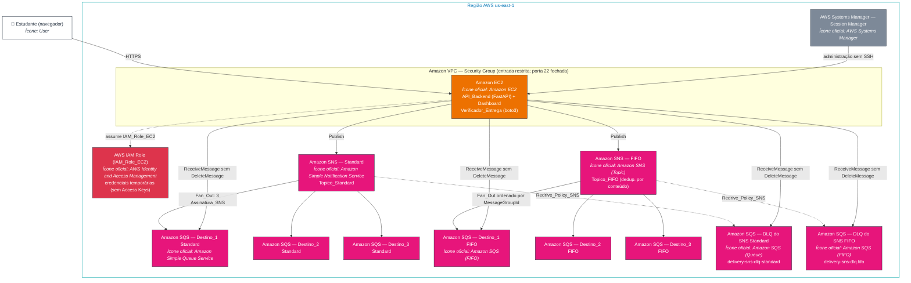
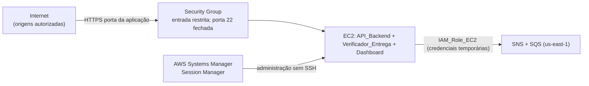

# Amazon SNS — Pub/Sub, Fan-out e Entrega Assíncrona · Arquitetura

> Documento de arquitetura do laboratório didático de **Amazon SNS**, voltado ao estudo da certificação **AWS Solutions Architect Associate (SAA)**. Descreve apenas o que o laboratório realmente faz: a aplicação **usa** recursos AWS criados manualmente e **nunca** cria, modifica nem exclui recursos AWS — a única exceção é o ajuste temporário e reversível da `Access_Policy_Fila` no cenário de `Falha_Entrega_Controlada`.

## Visão geral

O **AWS SNS Delivery Lab** é uma aplicação web em português do Brasil (pt-BR) que demonstra, de forma visual, o ciclo de vida completo das mensagens publicadas pelo **Amazon SNS**: publicação em tópicos, distribuição **fan-out** para múltiplas assinaturas, ordenação de mensagens (Standard vs FIFO), confirmação de entrega real nas filas de destino, falha de entrega controlada e encaminhamento para a **Dead-Letter Queue (DLQ) do SNS**.

O laboratório foca **exclusivamente no Amazon SNS**. O **Amazon SQS** participa **apenas como destino** das mensagens publicadas pelo SNS (padrão fan-out). Nenhuma funcionalidade educacional específica de SQS é desenvolvida aqui: as filas SQS existem somente para receber as entregas do SNS e permitir a **confirmação real** dessas entregas por meio de leitura não destrutiva.

O cenário educacional é um fluxo de **delivery de comida**: após a aprovação de uma compra, o SNS distribui a mensagem para três destinos — **Destino_1** (confirmação da aprovação da compra), **Destino_2** (solicitação para a cozinha preparar o alimento) e **Destino_3** (solicitação para o motoboy buscar o pedido). O Dashboard apresenta a notificação visual em pt-BR "Seu pedido foi aprovado e está sendo preparado". Essa notificação é **apenas visual**: o laboratório **não envia SMS nem e-mails reais**.

Toda a aplicação é executada em uma instância **Amazon EC2** Linux na região `us-east-1`. O backend em **Python** usa `FastAPI` e `boto3`: a **API_Backend** expõe os endpoints consumidos pelo Dashboard e hospeda o processo **Verificador_Entrega**. O **Dashboard** (HTML/CSS/JS) consome a API e apresenta as quatro ações principais em pt-BR: "DISPARAR SNS STANDARD", "DISPARAR SNS FIFO", "COMPARAR STANDARD X FIFO" e "TESTAR DLQ DO SNS".

A autenticação com a AWS ocorre **exclusivamente** pela **IAM_Role_EC2** anexada ao perfil da instância: o `boto3` resolve as credenciais temporárias pela cadeia de provedores padrão (via metadata service da EC2, IMDSv2), sem nenhuma Access Key fixa em código, configuração ou variável de ambiente.

A **confirmação de entrega** de cada mensagem é obtida pela **leitura real das filas SQS de destino** via `boto3`, correlacionando as mensagens pelo **ID_Pedido**. A aplicação distingue de forma explícita e didaticamente honesta dois estados: **Entrega_Publicada** (o SNS aceitou publicar e retornou um `MessageId`) e **Entrega_Confirmada** (a mensagem foi efetivamente lida na fila de destino correspondente). Quando a verificação não confirma a mensagem dentro do tempo-limite, o estado exibido é **"Não confirmado"**, nunca "entregue".

Decisões de arquitetura relevantes:

| Decisão | Motivação |
|---------|-----------|
| Confirmação de entrega **somente** por leitura real da fila de destino | O SNS retornar um `MessageId` significa apenas que a publicação foi aceita, não que a mensagem chegou ao destino. A honestidade didática exige distinguir `Entrega_Publicada` de `Entrega_Confirmada`. |
| Leitura **não destrutiva** das filas de destino (sem `DeleteMessage`) | As filas podem conter mensagens de outros testes ou usuários. O Verificador_Entrega apenas visualiza, usando `VisibilityTimeout` curto e sem exclusão, preservando mensagens de terceiros. |
| Distinção explícita entre `Evento_Observado` e `Evento_Inferido` | Separar o que foi confirmado via AWS (publicação com `MessageId`, leitura confirmada na fila/DLQ) do que é apenas deduzido. |
| Dois timeouts distintos: `Timeout_Verificacao_Entrega` e `Timeout_Verificacao_DLQ` | A entrega em fila de destino é rápida (padrão 30s, faixa 5–120s); o encaminhamento para a DLQ do SNS depende da política de retry do SNS e é mais lento (padrão 120s, faixa 30–300s). |
| Falha de entrega **controlada e reversível** via `Access_Policy_Fila` | Para demonstrar a DLQ do SNS sem excluir recursos, adiciona-se um statement `Deny` temporário; ao final, a policy original é restaurada integralmente. |
| `Deduplicacao_Por_Conteudo` **habilitada por padrão** no `Topico_FIFO` | Simplifica o cenário FIFO: o `MessageDeduplicationId` é gerado pelo conteúdo, dispensando sua informação manual. |
| Recursos AWS criados **manualmente** (sem IaC) | Objetivo didático: praticar criação e configuração no Console AWS. |
| Autenticação exclusiva via **IAM_Role_EC2** | Boa prática de segurança: nenhuma Access Key fixa em código, config ou variável de ambiente. |
| Sem **NAT Gateway** e sem **Elastic Load Balancer**; administração via **Session Manager** | Controle de custo e redução da superfície de ataque (porta 22/SSH sem regra de entrada). |

## Serviços AWS utilizados e suas funções

| Serviço AWS | Recurso no laboratório | Função |
|-------------|------------------------|--------|
| **Amazon SNS (Standard)** | `Topico_Standard` (tipo Standard) | Tópico do cenário Standard; recebe a publicação (`Publish`) e distribui a mensagem em **fan-out** para as três assinaturas Standard, sem garantia de ordenação. |
| **Amazon SNS (FIFO)** | `Topico_FIFO` (tipo FIFO, `Deduplicacao_Por_Conteudo` habilitada) | Tópico do cenário FIFO; recebe a publicação com `MessageGroupId` e distribui em **fan-out** para as três assinaturas FIFO, garantindo ordenação dentro do mesmo `MessageGroupId`. |
| **Amazon SQS (Standard — destino)** | Três `Fila_Destino_Standard` (Destino_1, Destino_2, Destino_3) | Destino do fan-out Standard; recebem as entregas do SNS e permitem a **confirmação real** por leitura não destrutiva. Não há funcionalidade educacional de SQS. |
| **Amazon SQS (FIFO — destino)** | Três `Fila_Destino_FIFO` (Destino_1, Destino_2, Destino_3) | Destino do fan-out FIFO; recebem as entregas ordenadas do SNS e permitem a confirmação real por leitura não destrutiva. |
| **Amazon SQS (DLQ do SNS — Standard)** | `DLQ_SNS_Standard` (`delivery-sns-dlq-standard`) | Dead-Letter Queue compartilhada das assinaturas do `Topico_Standard`, apontada pela `Redrive_Policy_SNS`; recebe as mensagens que o SNS não conseguiu entregar. |
| **Amazon SQS (DLQ do SNS — FIFO)** | `DLQ_SNS_FIFO` (`delivery-sns-dlq.fifo`) | Dead-Letter Queue compartilhada das assinaturas do `Topico_FIFO`, apontada pela `Redrive_Policy_SNS`; recebe as mensagens FIFO não entregues. |
| **Amazon EC2** | Instância Linux (us-east-1) | Hospeda a API_Backend (FastAPI), o Verificador_Entrega e serve o Dashboard. |
| **AWS IAM (IAM Role)** | `IAM_Role_EC2` | Fornece credenciais temporárias de privilégio mínimo para a aplicação acessar SNS e SQS, sem Access Keys fixas. |
| **AWS Systems Manager — Session Manager** | `Session_Manager` | Acesso administrativo à EC2 sem abrir a porta 22 (SSH) no Security Group. |

> As seis `Assinatura_SNS` (três do `Topico_Standard` para as filas Standard e três do `Topico_FIFO` para as filas FIFO) são o elo do fan-out. Cada assinatura tem uma `Redrive_Policy_SNS` apontando para a DLQ compatível com o seu tipo (Standard → `delivery-sns-dlq-standard`; FIFO → `delivery-sns-dlq.fifo`). A `Access_Policy_Fila` de cada fila de destino autoriza apenas o tópico SNS correspondente a publicar (principal `sns.amazonaws.com`, condição por `SourceArn` do tópico).

## Diagrama de arquitetura (ícones oficiais AWS)

O diagrama abaixo representa a arquitetura usando a convenção visual dos **AWS Architecture Icons** oficiais. Cada caixa referencia o ícone oficial do serviço correspondente (catálogo [AWS Architecture Icons](https://aws.amazon.com/architecture/icons/)). As classes de cor seguem a paleta oficial por categoria de serviço (laranja para Compute, rosa/magenta para App Integration, vermelho para Security, cinza para Management).

## Diagrama único de todos os fluxos (Mermaid)

O diagrama a seguir cobre, em um único grafo, **todos** os fluxos do laboratório: disparo Standard e FIFO, fan-out para as três filas de destino de cada tipo, confirmação de entrega por leitura não destrutiva, comparação Standard x FIFO, falha de entrega controlada (statement `Deny` temporário) e encaminhamento para a DLQ do SNS. As linhas tracejadas representam movimentações automáticas do SNS; as pontilhadas representam o ajuste reversível de `Access_Policy_Fila`.

```mermaid
flowchart TD
    DASH["Dashboard (pt-BR)"]
    API["API_Backend (FastAPI)"]
    SNSGW["SnsGateway (boto3)"]
    VERIF["Verificador_Entrega"]
    SQSRGW["SqsLeituraGateway (somente leitura)"]
    GFC["Gerenciador_Falha_Controlada"]
    TS[/"Topico_Standard<br/>SNS Standard"/]
    TF[/"Topico_FIFO<br/>SNS FIFO"/]
    QS[("Filas de destino Standard<br/>Destino_1..3")]
    QF[("Filas de destino FIFO<br/>Destino_1..3")]
    DLQS[("DLQ_SNS_Standard<br/>delivery-sns-dlq-standard")]
    DLQF[("DLQ_SNS_FIFO<br/>delivery-sns-dlq.fifo")]

    %% Disparo Standard
    DASH -->|"POST /api/disparar/standard (ID_Pedido)"| API
    API -->|publicar_standard| SNSGW
    SNSGW -->|"Publish"| TS
    SNSGW -.->|"MessageId -> Entrega_Publicada (OBSERVADO)"| API

    %% Disparo FIFO
    DASH -->|"POST /api/disparar/fifo (ID_Pedido, MessageGroupId)"| API
    API -->|publicar_fifo| SNSGW
    SNSGW -->|"Publish (MessageGroupId; dedup por conteúdo)"| TF
    SNSGW -.->|"MessageId -> Entrega_Publicada (OBSERVADO)"| API

    %% Fan-out
    TS -->|"Fan_Out: 3 Assinatura_SNS"| QS
    TF -->|"Fan_Out ordenado por MessageGroupId"| QF

    %% Comparação Standard x FIFO
    DASH -->|"POST /api/comparar"| API

    %% Confirmação de entrega (leitura não destrutiva)
    API -->|verificar_entrega| VERIF
    VERIF -->|"ReceiveMessage (Long Polling 1-20s, sem DeleteMessage)"| SQSRGW
    SQSRGW -->|correlaciona por ID_Pedido| QS
    SQSRGW --> QF
    VERIF -.->|"ID_Pedido correlacionado -> Entrega_Confirmada (OBSERVADO)"| API
    VERIF -.->|"Timeout_Verificacao_Entrega -> Não confirmado"| API

    %% Falha de entrega controlada e DLQ do SNS
    DASH -->|"POST /api/dlq/simular-falha (Assinatura_SNS)"| API
    API -->|salvar_policy_original + aplicar_deny_temporario| GFC
    GFC -.->|"statement Deny temporário (sns.amazonaws.com + SourceArn)"| QS
    API -->|Publish mensagem de teste| SNSGW
    QS -.->|"SNS tenta entregar, é negado"| TS
    TS -.->|"Redrive_Policy_SNS: encaminha à DLQ"| DLQS
    TF -.->|"Redrive_Policy_SNS: encaminha à DLQ"| DLQF
    VERIF -->|"verificar_dlq (até Timeout_Verificacao_DLQ, sem DeleteMessage)"| SQSRGW
    SQSRGW --> DLQS
    SQSRGW --> DLQF
    API -->|restaurar_policy ao final| GFC
    GFC -.->|"remove Deny / restaura policy original"| QS

    %% Leitura pelo Dashboard
    API -->|"GET /api/estatisticas, /api/config, /api/saude"| DASH
    DASH -->|"atualização periódica (5-300s, padrão 10s)"| API
```

## Fluxos detalhados

### Fluxo fan-out Standard

1. O Dashboard chama `POST /api/disparar/standard` com o `ID_Pedido` (1 a 80 caracteres). A API valida o payload antes de qualquer chamada à AWS.
2. A `API_Backend` publica no `Topico_Standard` via `SnsGateway.publicar_standard` (com `MessageAttributes` carregando `id_pedido` e `cenario`). O SNS retorna um `MessageId`, registrado como `Evento_Observado` de **Entrega_Publicada**.
3. O **fan-out** entrega a mensagem, em paralelo, às três `Assinatura_SNS` do tópico, que a depositam nas três `Fila_Destino_Standard` (Destino_1, Destino_2, Destino_3).
4. O **Verificador_Entrega** lê cada fila de destino com `ReceiveMessage` + **Long Polling** (sem `DeleteMessage`), correlaciona pelo `ID_Pedido` e registra, por destino confirmado, um `Evento_Observado` de **Entrega_Confirmada** (com fila, `ID_Pedido` e `MessageId`).
5. O Dashboard exibe o tópico, o tipo Standard, o `ID_Pedido`, o `MessageId`, os três destinos e a notificação visual "Seu pedido foi aprovado e está sendo preparado". Se algum destino não for confirmado dentro do `Timeout_Verificacao_Entrega`, o estado é **"Não confirmado"**, nunca "entregue".

> O `Topico_Standard` **não garante ordenação**. A ação "COMPARAR STANDARD X FIFO" publica três mensagens sequenciais ("Pedido criado", "Compra aprovada", "Pedido em preparação"), lê as filas de destino e apresenta, lado a lado, a ordem de publicação e a ordem de recebimento. A aplicação **não** simula artificialmente mensagens fora de ordem.

### Fluxo fan-out FIFO

1. O Dashboard chama `POST /api/disparar/fifo` com o `ID_Pedido` (1 a 80 caracteres) e o `MessageGroupId` (1 a 128 caracteres). Como a `Deduplicacao_Por_Conteudo` do `Topico_FIFO` está **habilitada**, a aplicação **não solicita nem aceita** `MessageDeduplicationId`.
2. A `API_Backend` valida o payload — uma publicação FIFO **sem** `MessageGroupId` é rejeitada antes da chamada ao SNS — e publica no `Topico_FIFO` via `SnsGateway.publicar_fifo`, sempre informando o `MessageGroupId`. O `MessageId` retornado é registrado como `Evento_Observado` de **Entrega_Publicada**.
3. O **fan-out** entrega às três `Fila_Destino_FIFO`, preservando a ordem das mensagens de um mesmo `MessageGroupId`.
4. O **Verificador_Entrega** lê as filas de destino de forma não destrutiva, correlaciona pelo `ID_Pedido` e registra as **Entrega_Confirmada** por destino.
5. O Dashboard exibe tópico, tipo FIFO, `ID_Pedido`, `MessageGroupId`, `MessageId` e os três destinos. A aplicação **apresenta** a ordem de recebimento observada na leitura, **sem reconstruir nem reordenar** as mensagens, refletindo a garantia de ordenação FIFO dentro do mesmo `MessageGroupId`.

### Fluxo de falha de entrega controlada e DLQ do SNS

1. Na ação "TESTAR DLQ DO SNS", o usuário seleciona uma `Assinatura_SNS` específica e aciona manualmente "SIMULAR FALHA DE ENTREGA" (execução manual obrigatória; sem loops ou automação).
2. O `Gerenciador_Falha_Controlada` **salva a `Access_Policy_Fila` original** da fila de destino daquela assinatura e aplica um **statement `Deny` temporário** para o principal `sns.amazonaws.com`, com condição por `SourceArn` do tópico correspondente — negando o recebimento daquela assinatura. **Nenhuma fila ou assinatura é excluída.**
3. A `API_Backend` publica uma mensagem de teste no tópico correspondente e verifica as **demais** assinaturas do mesmo tópico (que devem confirmar normalmente).
4. O SNS tenta entregar à fila negada, é recusado e, pela `Redrive_Policy_SNS` da assinatura, encaminha a mensagem à **DLQ do SNS compatível** (`delivery-sns-dlq-standard` ou `delivery-sns-dlq.fifo`).
5. O **Verificador_Entrega** lê a DLQ (leitura não destrutiva) aguardando até o `Timeout_Verificacao_DLQ` (padrão 120s, faixa 30–300s). Ao confirmar a mensagem, o Dashboard a exibe na DLQ como `Evento_Observado`; se o timeout for atingido sem confirmação, exibe **"Não confirmado"**, sem indicar sucesso.
6. Ao final, o `Gerenciador_Falha_Controlada` **restaura integralmente** a `Access_Policy_Fila` original. Se a restauração falhar, o Dashboard identifica a fila afetada e orienta a restauração manual pelo Console AWS.

> O timeout da DLQ é maior que o da entrega direta porque o encaminhamento à DLQ do SNS depende da política de retry do próprio SNS, sendo naturalmente mais lento que a entrega direta à fila de destino.

## Integração com as filas de destino

As filas SQS de destino existem **apenas** para receber as entregas do SNS e permitir a confirmação real. A integração obedece a regras estritas de leitura **não destrutiva**, encapsuladas no `SqsLeituraGateway` (restrito a operações de leitura) e orquestradas pelo `Verificador_Entrega`:

- Usa `ReceiveMessage` com **Long Polling** (`WaitTimeSeconds` de 1 a 20 s, até 20 s no cenário padrão) para reduzir chamadas vazias.
- **Nunca** chama `DeleteMessage`; usa `VisibilityTimeout` curto para que a mensagem volte a ficar visível a outros testes ou usuários.
- Correlaciona cada mensagem recebida pelo `ID_Pedido` extraído do envelope SNS (campos `Message` e `MessageAttributes`); mensagens não correlacionadas ao teste em execução são **ignoradas e preservadas**.
- Repete as tentativas apenas até atingir o `Timeout_Verificacao`, sem registrar erro quando o retorno vem vazio.
- Ao atingir o timeout sem correlacionar o `ID_Pedido`, retorna o estado **"Não confirmado"**, nunca "entregue".
- Não configura DLQ de processamento nas filas de destino: o uso de DLQ limita-se ao encaminhamento configurado na `Assinatura_SNS` (DLQ do SNS).

**Limitação e honestidade didática:** como a leitura é não destrutiva e as filas são compartilhadas, não há garantia de ver todas as mensagens em uma única chamada; a aplicação lê repetidamente até o `Timeout_Verificacao` e, se não correlacionar o `ID_Pedido`, exibe "Não confirmado" de forma transparente, sem afirmar entrega.

## Integração com o Dashboard

O **Dashboard** (HTML/CSS/JS, pt-BR, título "AWS SNS Delivery Lab") é servido pela EC2 e consome a `API_Backend` exclusivamente por HTTP sob o prefixo `/api`. Ele exibe a representação visual da arquitetura (dois tópicos com tipo, seis assinaturas, seis filas de destino e duas DLQs), as quatro ações principais, as estatísticas separadas por cenário, o horário da última atualização e os indicadores textuais distintos de `Config_Aplicada`/`Config_Simulacao` e de `Entrega_Publicada`/`Entrega_Confirmada`.

| Ação no Dashboard | Endpoint da API_Backend | Responsabilidade |
|-------------------|-------------------------|------------------|
| Login com bloqueio por origem | `POST /api/autenticacao` | Usuário/senha; bloqueio após 5 falhas consecutivas por 300 s. |
| Verificação de inicialização | `GET /api/saude` | Confirma existência e acessibilidade dos recursos AWS antes de liberar o Dashboard. |
| Config_Aplicada e Config_Simulacao | `GET /api/config` | Retorna os parâmetros com rótulos distintos. |
| Ajuste de Config_Simulacao | `PUT /api/config/simulacao` | Ajusta `Timeout_Verificacao_Entrega` e `Timeout_Verificacao_DLQ` dentro das faixas. |
| DISPARAR SNS STANDARD | `POST /api/disparar/standard` | Publica no `Topico_Standard` e dispara a verificação de entrega. |
| DISPARAR SNS FIFO | `POST /api/disparar/fifo` | Publica no `Topico_FIFO` (`MessageGroupId`) e dispara a verificação. |
| COMPARAR STANDARD X FIFO | `POST /api/comparar` | Executa dois testes independentes e retorna os resultados lado a lado. |
| TESTAR DLQ DO SNS | `POST /api/dlq/simular-falha` | Prepara a `Falha_Entrega_Controlada`, publica, verifica a DLQ e restaura a policy. |
| Visão geral / estatísticas | `GET /api/estatisticas` | Estatísticas por cenário (publicadas, confirmadas, DLQ) e horário da última atualização. |
| Arquitetura visual | `GET /api/arquitetura` | Dados da representação visual da arquitetura. |

Características transversais da integração:

- As estatísticas são atualizadas periodicamente (intervalo configurável de 5 a 300 s, padrão 10 s) **sem recarregar a página**; se a atualização falhar, o Dashboard preserva os últimos valores válidos e sinaliza possível desatualização.
- Cada teste roda apenas por **acionamento manual**; enquanto ativo, o botão correspondente fica desabilitado e é reabilitado ao concluir ou interromper.
- A `API_Backend` aplica timeout de 3 s no percentil 95 sob 10 requisições simultâneas em `/api/estatisticas` e nos resultados de teste; ao exceder, retorna indicação de timeout e o Dashboard mantém os últimos dados válidos.
- As credenciais da AWS **nunca** são expostas no navegador.

## Permissões IAM (privilégios mínimos)

A `IAM_Role_EC2` é a **única** forma de autenticação da aplicação com a AWS: o `boto3` resolve credenciais temporárias pelo metadata service da EC2, sem Access Keys fixas em código, configuração ou variáveis de ambiente. A role concede **somente** as ações necessárias ao laboratório, sem privilégios administrativos nem acesso a outros recursos AWS.

| Permissão IAM (ação) | Alvo | Para que serve |
|----------------------|------|----------------|
| `sns:Publish` | Os dois tópicos (`Topico_Standard`, `Topico_FIFO`) | Publicar as mensagens dos cenários Standard, FIFO, comparação e teste de DLQ. |
| `sns:ListTopics` | `*` | Listar os tópicos para compor a representação visual da arquitetura. |
| `sns:GetTopicAttributes` | Os dois tópicos | Confirmar o tipo do tópico e a `Deduplicacao_Por_Conteudo` do FIFO (Config_Aplicada). |
| `sns:ListSubscriptionsByTopic` | Os dois tópicos | Listar as `Assinatura_SNS` para apresentar a arquitetura e permitir a seleção no teste de DLQ. |
| `sns:GetSubscriptionAttributes` | Assinaturas da conta na região (`arn:aws:sns:us-east-1:<conta>:*`) | Ler a `Redrive_Policy_SNS` e demais atributos de cada assinatura. |
| `iam:GetRole` | A própria `IAM_Role_EC2` | Confirmar, na **verificação de inicialização**, que a IAM Role existe e está acessível. |
| `ec2:DescribeInstances` | `*` (restrito à região `us-east-1` por condição) | Confirmar, na **verificação de inicialização**, que a instância EC2 existe e está acessível. Sem esta ação a verificação falha e o Dashboard não é servido. |
| `sqs:ReceiveMessage` | As seis filas de destino e as duas DLQs | Ler as mensagens (leitura não destrutiva) para confirmar as entregas e as presenças na DLQ. |
| `sqs:GetQueueAttributes` | As seis filas de destino e as duas DLQs | Consultar atributos (ex.: `Access_Policy_Fila`, contagens) na verificação de inicialização e na preparação da falha controlada. |
| `sqs:GetQueueUrl` | As seis filas de destino e as duas DLQs | Resolver a URL de cada fila a partir do nome. |
| `sqs:SetQueueAttributes` | A fila de destino da assinatura selecionada no teste de DLQ | Ajustar **temporariamente** a `Access_Policy_Fila` (aplicar o `Deny` e restaurar a policy original) no cenário de `Falha_Entrega_Controlada`. É a única permissão de escrita, usada apenas nesse cenário reversível. |

Resumo dos privilégios mínimos: **publicar nos tópicos**, **listar e consultar tópicos e assinaturas**, **confirmar a IAM Role e a instância EC2** na verificação de inicialização, **ler filas de destino e DLQs** e **ajustar temporariamente a Access Policy** da fila alvo do teste de DLQ. Não há permissões para criar, modificar ou excluir tópicos, assinaturas ou filas, nem qualquer ação administrativa. A única permissão de escrita é o `sqs:SetQueueAttributes`, usada exclusivamente no ajuste reversível do teste de DLQ.

Complementam a segurança:

- A `Access_Policy_Fila` de cada fila de destino autoriza a publicação **apenas** pelo tópico SNS correspondente (principal `sns.amazonaws.com`, condição por `SourceArn`), rejeitando outras origens.
- O Dashboard, quando exposto à internet, exige usuário/senha e bloqueia a origem após 5 falhas consecutivas por 300 s, restringindo o acesso às origens autorizadas.
- Qualquer falha de autorização via `IAM_Role_EC2` interrompe a operação afetada, registra o evento e expõe o erro sem persistir dados parciais.

## Topologia de rede e implantação

A arquitetura **não** usa `NAT Gateway` nem `Elastic Load Balancer` (salvo justificativa técnica documentada), para controle de custos. A administração da EC2 ocorre apenas via **Session Manager**, com a porta 22 (SSH) sem regra de entrada liberada no Security Group. Todos os recursos AWS são criados **manualmente** no Console AWS (sem IaC); a aplicação apenas verifica e usa os recursos existentes, com a única exceção do ajuste temporário e reversível da `Access_Policy_Fila` no cenário de `Falha_Entrega_Controlada`. O passo a passo numerado de criação, verificação e exclusão dos recursos está em `IMPLANTACAO.md`.

### Imagens da arquitetura implantada

Representação visual da arquitetura no Dashboard (dois tópicos com tipo, assinaturas em fan-out e as DLQs):

.png)

Rede: a VPC do laboratório com sub-redes, tabela de rotas e Internet Gateway:

.png)

Compute: a instância EC2 que hospeda a API_Backend, o Verificador_Entrega e o Dashboard (com IP elástico e IMDSv2):

.png)

Segurança: a IAM_Role_EC2 de privilégio mínimo anexada à instância (sem Access Keys):

.png)

Em produção, o processo da aplicação roda como um serviço **systemd** (`deploy/sns-delivery-lab.service`), e não com um `uvicorn` avulso: isso garante um único processo dono da porta da aplicação (evitando conflitos de `address already in use`), reinício automático em falha e start no boot da instância. Os parâmetros sensíveis (usuário/senha do Dashboard e identificadores do laboratório) vêm de um `EnvironmentFile` fora do repositório; nenhuma Access Key da AWS é definida ali, pois a autenticação permanece pela `IAM_Role_EC2`. O passo a passo de instalação do serviço está na Etapa 12 do `IMPLANTACAO.md`.
